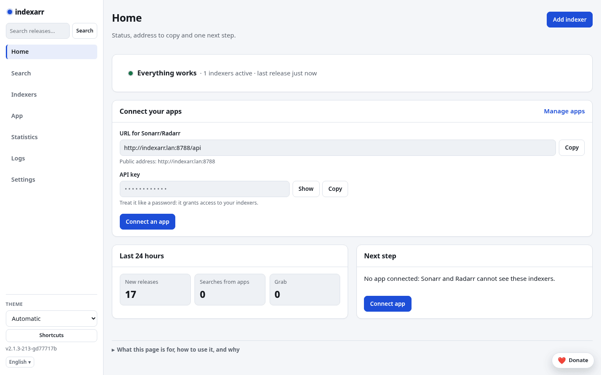
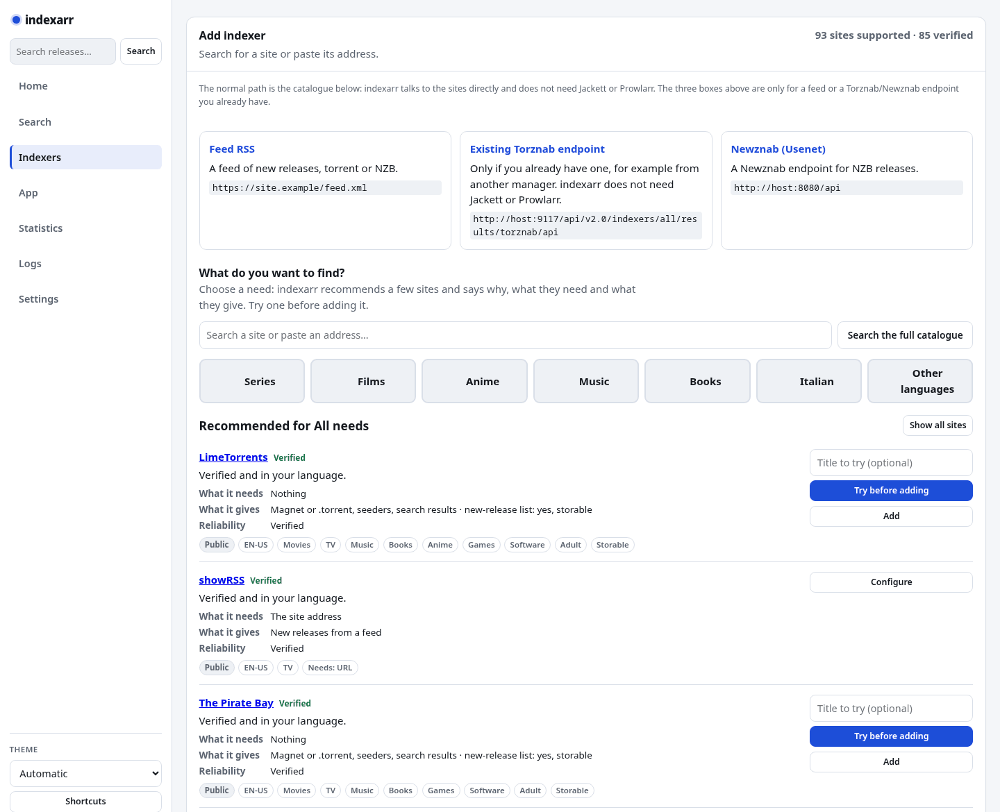
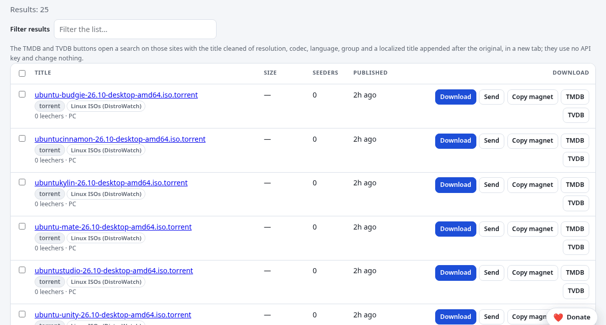

# indexarr

**Self-hosted torrent and Usenet indexer, Torznab/Newznab compatible.**
indexarr builds a local index of releases, keeps it up to date and exposes it
to Sonarr, Radarr, Lidarr, Readarr, Whisparr, Mylar3, LazyLibrarian, the other
managers of the Servarr family or any Torznab client. It was created to replace
Jackett and Prowlarr in the daily workflow: native sources, SQLite cache, live
search, app synchronization and a complete web interface, with no mandatory
external services.

It does not download the content of torrents or NZBs: it builds a searchable
**index**. Downloading remains with the chosen client — qBittorrent,
Transmission, Deluge, rTorrent, SABnzbd, NZBGet, aMule and others.

```
Native sources / RSS / Newznab ──► scheduler ──► normalization ──► SQLite
                                                                      │
  Sonarr / Radarr / Lidarr / Readarr and forks ◄── Torznab / Newznab ─┤
                          Browser ◄── web UI SSR + JSON API ──────────┘
```

**[Installation](docs/INSTALLATION.md)** ·
**[Features](docs/FEATURES.md)** ·
**[Compatibility and limits](docs/COMPATIBILITY.md)** ·
**[Supported sources](docs/SUPPORTED.md)** ·
[Wiki](https://github.com/buzzqw/indexarr/wiki) ·
[User manual](https://github.com/buzzqw/indexarr/wiki/User-Manual) ·
[Manuale utente](https://github.com/buzzqw/indexarr/wiki/Manuale-Utente) ·
[Torznab API](https://github.com/buzzqw/indexarr/wiki/Torznab-API) ·
[Admin JSON API](https://github.com/buzzqw/indexarr/wiki/Admin-API)

## A look

A fresh test instance with a single public feed of Linux distribution ISOs.



| | |
|---|---|
|  |  |
| **Add indexer.** The native catalogue says what each site needs, what it gives and how reliable it is; try a site before adding it. | **Search.** The stored catalogue and the live search share one page; every row names its source and can go straight to your client. |

## Why indexarr

- **One binary, no stack to run.** SQLite without CGO, no database server, no
  external service, no container required.
- **It replaces Jackett and Prowlarr**, it does not proxy them: a native
  catalog of site definitions and family connectors, plus any direct
  Torznab/Newznab endpoint, RSS feed, eD2k source or Rats Search node.
- **The cache is real.** Releases stay searchable when a site is slow or down,
  with deduplication, full-text search and retention.
- **Torrents, Usenet and eD2k on one endpoint.** Torznab and Newznab together,
  with caps, search, tvsearch, movie, music, book and download.
- **A complete web interface**: search, sources, app sync, clients,
  statistics, logs, maintenance, backup and restore.
- **Built for daily operation**: per-host rate limit, circuit breaker, learned
  pace, mirrors, multiple API keys, vault for secrets and CSRF protection.

## What sets it apart

- **One site, one voice.** Sources that share a definition — the thirteen
  TorrentGalaxy uploaders, the ExtTo channels — take turns inside the site's
  interval, and a periodic pass reads at most one of them at a time. A site
  never receives thirteen crawls in the same minute.
- **Live search merged with the cache.** Every app query asks the enabled
  sources that can search, saves what arrives in time and returns one row per
  release; the stored catalogue remains the fallback.
- **A problem is what is happening now.** The stored error of a source is
  cleared as soon as a check or a run succeeds, and every cause has its own
  sentence: rate limit, flood control, DNS, page changed.
- **No fixed release needed to fix a site.** The remote catalog imports
  validated definitions from a directory; your own edits are never overwritten.
- **The apps work without waiting for indexarr.** The generic
  Servarr-compatible type covers the forks of the family, so a new client can
  be connected today.

Full detail: [Features](docs/FEATURES.md).

## Install

| Path | When to choose it | Command |
| --- | --- | --- |
| **Prebuilt archive** | you only want to run it | unpack, `./install.sh` |
| **install.sh** | from a checkout | `./install.sh` |
| **Docker** | container, NAS, one volume | `docker compose up -d --build` |
| **From source** | development, host without systemd | `make build && ./bin/indexarr` |

Ready-to-run archives of the current code are published on the
[continuous release](https://github.com/buzzqw/indexarr/releases/tag/continuous)
(`linux/amd64`, `linux/arm64`):

```bash
curl -LO https://github.com/buzzqw/indexarr/releases/download/continuous/indexarr-linux-amd64.tar.gz
curl -LO https://github.com/buzzqw/indexarr/releases/download/continuous/SHA256SUMS
sha256sum -c SHA256SUMS --ignore-missing
tar xzf indexarr-linux-amd64.tar.gz
cd indexarr-*-linux-amd64 && ./install.sh
```

`install.sh` starts a **systemd user service** without `sudo`, with data in the
`data/` directory of the checkout or of the unpacked archive; `--system`
installs a system-wide unit with data in `/var/lib/indexarr`, `--status` and
`--uninstall` inspect and remove it (data is kept). The page is on
<http://localhost:8788>: set a username and password in **Settings** before
exposing it to the LAN.

Requirements: **Linux with systemd** or **Docker with Compose**; the binary
itself has no runtime dependencies. **Go 1.26 or later** only to build from
source. Optional: FlareSolverr for Cloudflare and a download client.

Installer flags, Docker, upgrade and rollback, building from source and the
`indexarr.json` configuration file: **[Installation](docs/INSTALLATION.md)**.

## Connect the apps

In **Settings** copy the full endpoint and give it to the client as a
**Torznab** indexer:

```text
http://<host>:8788/api?apikey=<API_KEY>
```

Categories are `5000` TV, `2000` Movies, `3000` Audio and `7000` Books. The
`/torznab/api` and `/newznab/api` aliases and the API key in the `X-Api-Key`
header also work.

App synchronization, per-app profiles, multiple API keys and live search:
[Connecting apps and clients](https://github.com/buzzqw/indexarr/wiki/Connecting-Apps).

## Compatibility

indexarr ships **more than a hundred native site definitions** — 1337x, The
Pirate Bay, YTS, EZTV, Nyaa, TorrentGalaxy, IPTorrents, MirCrew, ExtTo,
CorsaroBlu, ilDraGoNeRo, DDUnlimited and many more — plus family connectors and
generic Torznab/Newznab/RSS/eD2k sources. Every site with its access method,
language and state is in **[docs/SUPPORTED.md](docs/SUPPORTED.md)**.

**Jackett and Prowlarr are not sources**: indexarr replaces them, there is no
import that reads them and no proxy towards them. The support matrix, the
Cloudflare/FlareSolverr path, Cardigann and the edge cases are in
[Compatibility and limits](docs/COMPATIBILITY.md).

## Documentation

| Document | Content |
| --- | --- |
| [Installation](docs/INSTALLATION.md) | archives, installer, Docker, upgrades, source build, `indexarr.json` |
| [Features](docs/FEATURES.md) | sources, cache and search, Torznab, web interface, apps, clients, notifications |
| [Compatibility and limits](docs/COMPATIBILITY.md) | support matrix and what indexarr does not do |
| [Supported sources](docs/SUPPORTED.md) | every site and connector, generated from the catalog |
| [Download confirmation](docs/DOWNLOAD_CONFIRMATION.md) | how a client reports a completed download |

The manuals live in the [GitHub wiki](https://github.com/buzzqw/indexarr/wiki);
the list of supported sources is generated from the catalog and lives in the
repository.

- [Wiki home](https://github.com/buzzqw/indexarr/wiki) — index of every page
- [User manual](https://github.com/buzzqw/indexarr/wiki/User-Manual) — step-by-step guide (English)
- [Manuale utente](https://github.com/buzzqw/indexarr/wiki/Manuale-Utente) — guida passo passo (italiano)
- [Installation](https://github.com/buzzqw/indexarr/wiki/Installation) — systemd installer, upgrades and Docker
- [Configuration](https://github.com/buzzqw/indexarr/wiki/Configuration) — `indexarr.json` and every setting with its default
- [Sources](https://github.com/buzzqw/indexarr/wiki/Sources) — catalog, RSS, Torznab, Usenet, eD2k, cookies and FlareSolverr
- [Connecting apps and clients](https://github.com/buzzqw/indexarr/wiki/Connecting-Apps) — Torznab endpoint, \*arr sync, API keys, live search
- [Web interface](https://github.com/buzzqw/indexarr/wiki/Web-Interface) — pages, search syntax, saved searches, rules and notifications
- [Operations](https://github.com/buzzqw/indexarr/wiki/Operations) — backup, maintenance, statistics, logs and security
- [Architecture](https://github.com/buzzqw/indexarr/wiki/Architecture) — packages and design choices
- [Definitions guide](https://github.com/buzzqw/indexarr/wiki/Definitions) — v1 format, fixtures, security
- [MirCrew](https://github.com/buzzqw/indexarr/wiki/MirCrew) — native definition, Smartfeed, FlareSolverr session
- [Compatibility](https://github.com/buzzqw/indexarr/wiki/Compatibility) — sources, edge cases, diagnostics
- [Torznab API](https://github.com/buzzqw/indexarr/wiki/Torznab-API) and [Administrative API](https://github.com/buzzqw/indexarr/wiki/Admin-API)
- [Vault](https://github.com/buzzqw/indexarr/wiki/Vault) — key, backup, Docker secrets
- [QA](https://github.com/buzzqw/indexarr/wiki/QA) — tests and smoke tests
- [Development](https://github.com/buzzqw/indexarr/wiki/Development) — build, test, pprof and the definitions CLI
- [Catalog](https://github.com/buzzqw/indexarr/wiki/Catalog) — states, numbers and live evidence per site
- [UI rules](https://github.com/buzzqw/indexarr/wiki/UI-Rules) — rules every page follows
- [Migration from Jackett/Prowlarr](https://github.com/buzzqw/indexarr/wiki/Migration-Managers)
- [Backlog](https://github.com/buzzqw/indexarr/wiki/Backlog) — open work, evidence and how to verify it

## Development

```bash
make test      # go test ./...
make vet       # go vet ./...
make qa        # vet + test + HTTP smoke test on the real binary
make build     # bin/indexarr
make release   # linux/amd64, linux/arm64, windows/amd64, darwin/arm64
make package   # self-contained archives in dist/ (linux/amd64, linux/arm64)
make publish   # dry run; PUBLISH_ARGS=--yes publishes the rolling release manually
make ui-smoke  # UI smoke test
make ci        # local CI, log in ci-logs/<commit>.log
```

The definitions CLI is `indexarr-def` (`validate`, `check-fixtures`,
`convert-cardigann`, `fmt`, `fingerprint`, `schema`). pprof, the complete
command list and the package structure:
[Development](https://github.com/buzzqw/indexarr/wiki/Development).

## Support the project

If indexarr is useful and you would like to support its development, a PayPal
donation is welcome — thank you. A **Donate** button is also always visible in
the UI, bottom right.

[](https://www.paypal.com/cgi-bin/webscr?cmd=_donations&business=azanzani@gmail.com&item_name=Support+indexarr+Project) [](https://ko-fi.com/buzzqw)

## Legal and fair use

indexarr is a **self-hosted indexer**. It does not host or distribute any
copyrighted content; it builds a local index of links from the sources you
configure.

- It reads **sources you configure**: native definitions, Torznab/Newznab
  endpoints and public RSS feeds. It ships no index of its own.
- What you search, download or stream is **your responsibility**. Use indexarr
  only for content you have the right to access — public domain, Creative
  Commons, or media you own.
- BitTorrent, Usenet and eD2k are neutral technologies; this project does not
  encourage or facilitate piracy.
- indexarr **replaces** Jackett and Prowlarr: it does not proxy them and does
  not read their configuration.
